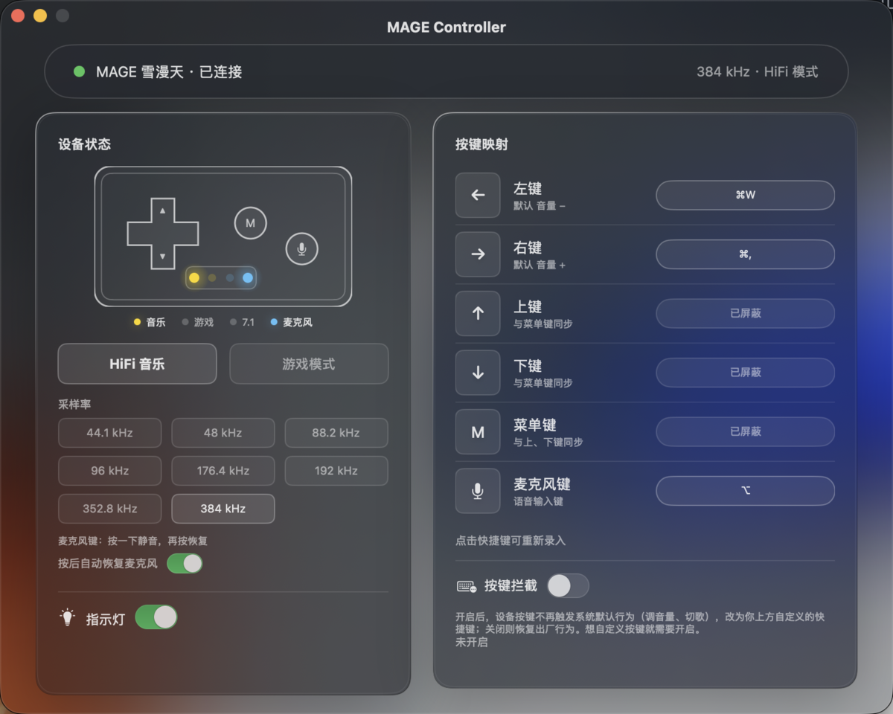

# MAGE Controller (macOS)

FiiO / SNOWSKY MAGE HiFi 游戏声卡的 macOS 第三方控制软件。



## 功能

- **按键自定义**：方向键 / Menu(M) 键 / 麦克风键全部可映射为任意快捷键、运行命令或屏蔽，
  带按键拦截（开启后设备不再触发系统默认的音量/切歌行为）
- **模式切换**：HiFi ↔ 游戏模式、7.1 虚拟环绕开关、麦克风开关、指示灯开关
- **采样率切换**：输出采样率 44.1k–384k 全档位（>48k 时设备音乐灯变黄，与线稿联动）
- **设备可视化**：严格按实机 55×30mm 比例的液态玻璃界面，4 盏指示灯颜色跟随真实状态
  （浅蓝/黄按采样率、7.1 灯闪烁）
- **菜单栏面板**：点击菜单栏图标快速查看状态/切换设置
- **免拦截架构 (v2)**：无需 root helper，普通用户态事件抑制

## 使用

1. 构建：`cd MageController && bash scripts/build-app.sh`
2. 运行 `dist/MAGE Controller.app`，授权「输入监控」后即可使用
3. 想自定义按键：开启「按键拦截」，给每个键录入快捷键

## 编译

**环境要求**：macOS 15+，安装 Xcode 命令行工具（`xcode-select --install`）。

**主应用**（唯一需要构建的产品）：

```bash
cd MageController
bash scripts/setup-signing.sh   # 只需一次：生成本机开发签名证书
bash scripts/build-app.sh       # 产出 dist/MAGE Controller.app
```

产物 `dist/MAGE Controller.app` 是免安装的绿色应用，拷到任意位置即可运行。

**首次运行的权限**（各允许一次，之后保留）：
- 系统设置 → 隐私与安全性 → **输入监控**：勾选 MAGE Controller（按键拦截需要）
- 若系统提示辅助功能授权，同样允许一次

**签名证书说明**：脚本用名为 `MAGE Dev Signing` 的自签名证书（存放在独立的
`~/Library/Keychains/mage-dev.keychain-db` 钥匙串，不碰系统钥匙串）。
原因是 adhoc 签名每次构建哈希都变，macOS 会当成新应用反复弹权限框；
固定证书后「输入监控」等授权跨构建保留。没有 Apple 开发者账号也能用，
代价是首次打开需在隐私设置里手动允许（Gatekeeper 对未公证应用的标准流程）。
已有开发者证书的话，把 `build-app.sh` 里的签名身份换成自己的即可分发。

**v2-poc/ 是什么**：免拦截按键架构（共享模式 HID 监听 + CGEventTap 抑制，
不独占设备）的概念验证，其结论已合并进主应用，**日常使用不需要编译它**。
想单独研究可 `cd v2-poc && swift run`，首次需在辅助功能里授权终端。

## 文档

- [CHECKLIST.md](CHECKLIST.md) — 回归测试清单（自动探针 + 人工验证）
- [AGENTS.md](AGENTS.md) — 开发日志与协议逆向结论（寄存器表、探针写法、已知限制）
- [MAGE_manual.pdf](MAGE_manual.pdf) — 官方说明书（指示灯颜色表的来源）

## 协议要点

设备有两个同名 HID 接口：`0x4022` = 厂商控制通道（本软件使用），`0x0144` = 无响应。
厂商协议为 64 字节报告帧，关键命令见 `AGENTS.md` 末节。
