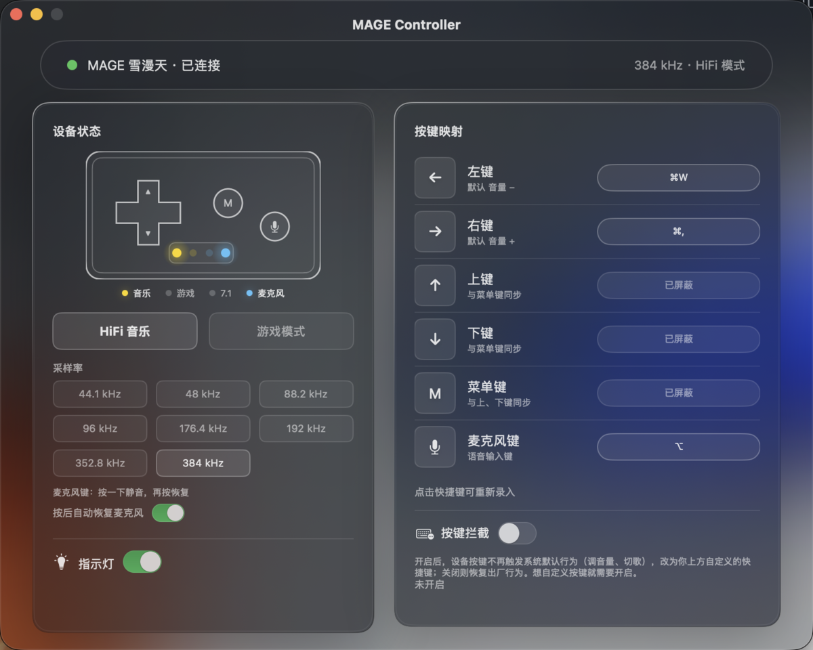

# 使用说明

## 这是什么

FiiO / SNOWSKY MAGE HiFi 游戏声卡的 macOS 第三方控制工具，让你可以自定义设备上
所有按键的行为，并直观查看设备状态（模式、采样率、4 盏指示灯）。

## 安装与首次运行

1. 构建（见 README「编译」章节），或直接拷贝 `MAGE Controller.app` 到任意位置
2. 首次启动，macOS 会提示未公证——在 **系统设置 → 隐私与安全性** 点「仍要打开」
3. 按提示授权两项权限（各允许一次，之后保留）：
   - **隐私与安全性 → 输入监控**：勾选 MAGE Controller
   - 若提示**辅助功能**授权，同样允许一次

App 常驻菜单栏（右上角手柄图标），点击弹出快捷面板；主窗口从面板或启动时打开。

## 核心概念：按键拦截

设备插在 Mac 上时，方向键/Menu 键默认触发系统行为（调音量、切歌）。

- **关闭按键拦截**（默认）：设备保持出厂行为
- **开启按键拦截**：设备按键不再触发系统默认行为，改为你配置的快捷键

想自定义按键就必须开启它。关闭后一切恢复出厂。

## 按键映射

主窗口「按键映射」区，点击任意键右侧的快捷键框重新录入：

- **录入**：点击框 → 变为「请按键盘…」→ 按下你想要的组合键（支持 ⇧⌃⌥⌘ 及
  左右区分，如「右⌘ + ,」）
- **屏蔽**：选择「屏蔽」后该键按下无任何效果
- **Shell 命令**：输入要运行的终端命令
- 麦克风键注意：按设备键 = 触发你录的快捷键（如右⌘ → Typeless 开始/结束说话），
  设备自身静音切换由固件管理，互不影响

## 设备状态区（左栏）

- **线稿图**：严格按实机 55×30mm 比例绘制，4 盏灯实时跟随设备真实状态
- **灯色**：PCM ≤48k 浅蓝、>48k 黄、7.1 灯 8 声道时闪烁、mic 灯开=浅蓝/关=灭
  （与官方说明书一致，见 `reference/MAGE_manual.pdf`）
- **采样率**：8 档可选。注意播放中的 App（Netflix、音乐等）会抢回采样率，
  手动切档在空闲时最稳定；切到 >48k 可以亲眼看到设备音乐灯变黄

## 常见问题

| 现象 | 原因 |
|------|------|
| 拔了设备后 MacBook 自带音量键没反应 | 旧版本 bug，v0.1 已修复，更新即可 |
| 切出 7.1 后要等一两秒 | 固件重启 USB 音频接口，正常现象 |
| 指示灯开关关了灯又亮 | 灯由固件管理，个别固件版本会自愈式恢复，非软件问题 |
| 软件显示 48.1 kHz 这类怪值 | 已修复（吸附标准档显示） |
| 想恢复出厂 | 设备上 M 键 + mic 键同按 1 秒（四灯红闪后重启） |

更多已知限制见 README 与 [checklist.md](checklist.md) 第三节。
